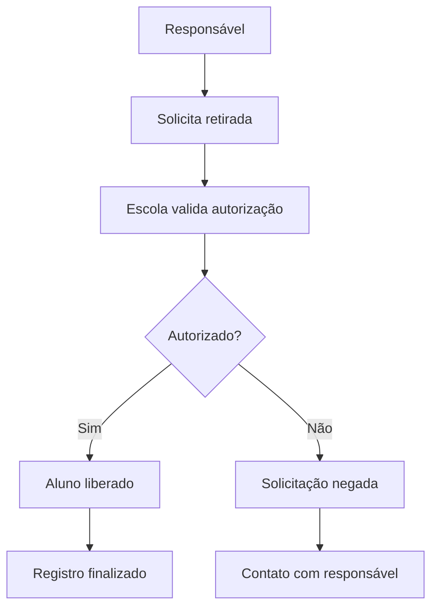

# Projeto Retirada Escolar

---

Este projeto tem como objetivo organizar e facilitar o processo de retirada escolar, proporcionando uma visão clara e estruturada sobre a rotina de alunos, responsáveis e acompanhamento escolar.

A proposta central é melhorar a gestão das saídas e entradas dos estudantes, tornando o processo mais seguro, eficiente e transparente.

## Objetivos

- Centralizar informações relacionadas à retirada escolar;
- Facilitar o acompanhamento de alunos e responsáveis;
- Reduzir falhas no processo de autorização e controle;
- Melhorar a comunicação entre escola e família;
- Organizar o fluxo de informações de forma simples e legível.

## Fluxo do Processo



## Estrutura do Repositório

Este repositório pode ser utilizado para:

- documentar regras e processos;
- armazenar diagramas e fluxos;
- registrar requisitos do projeto;
- evoluir com novas funcionalidades e versões.

## Possíveis áreas de desenvolvimento

- Cadastro de alunos;
- Cadastro de responsáveis;
- Controle de autorizações;
- Registro de retiradas;
- Histórico de movimentações;
- Dashboard de acompanhamento.

## Como usar

1. Clone este repositório;
2. Explore os arquivos e diagramas disponíveis;
3. Ajuste os conteúdos conforme as regras do projeto;
4. Documente novas funcionalidades e evoluções.

```bash
git clone https://github.com/beatrp/Projeto-Retirada-Escolar.git
cd Projeto-Retirada-Escolar
```

## Observações

Este README foi criado como base inicial para apresentar o objetivo do projeto e facilitar a organização do repositório.

Se quiser, posso também personalizar este README para um formato mais profissional, acadêmico ou técnico, incluindo:

- badges;
- instalação e execução;
- arquitetura do sistema;
- roadmap;
- documentação de requisitos;
- modelo de fluxo de trabalho.

## Licença

Este projeto ainda não possui uma licença definida. Caso seja necessário, pode-se adicionar uma licença como MIT ou Apache 2.0.
